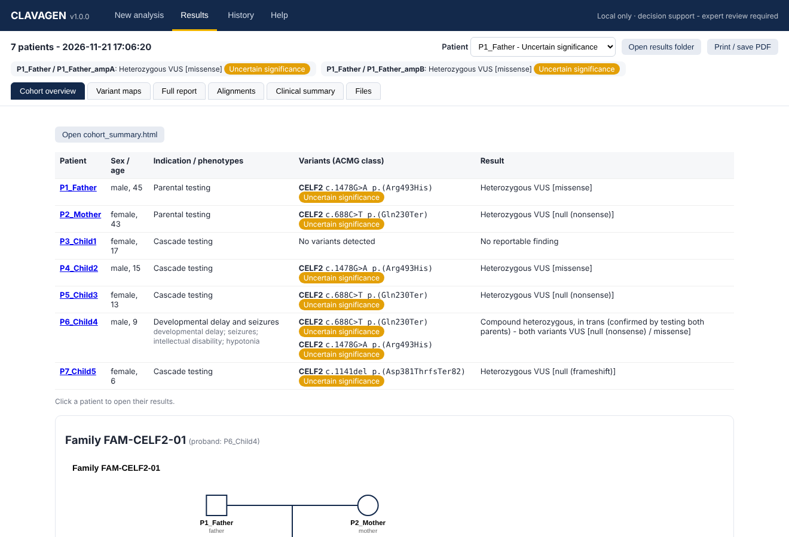
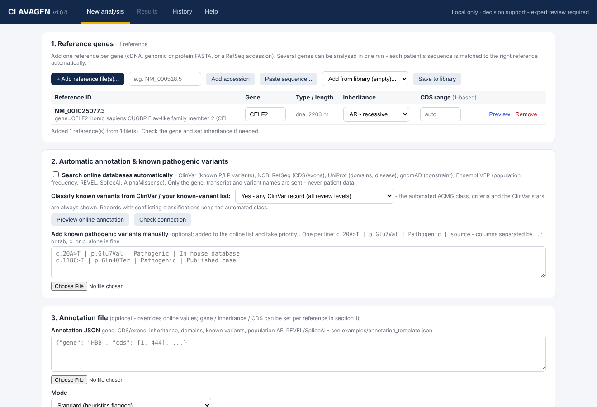
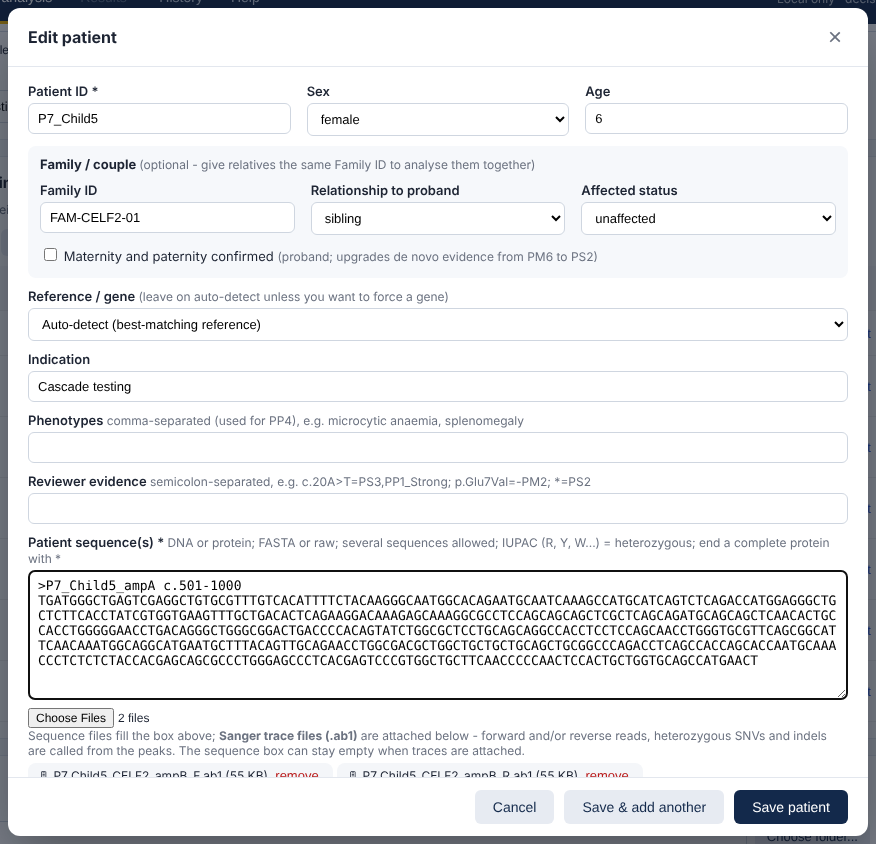
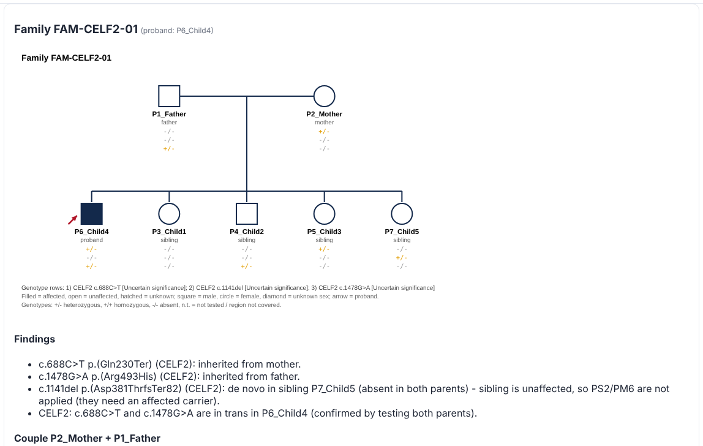
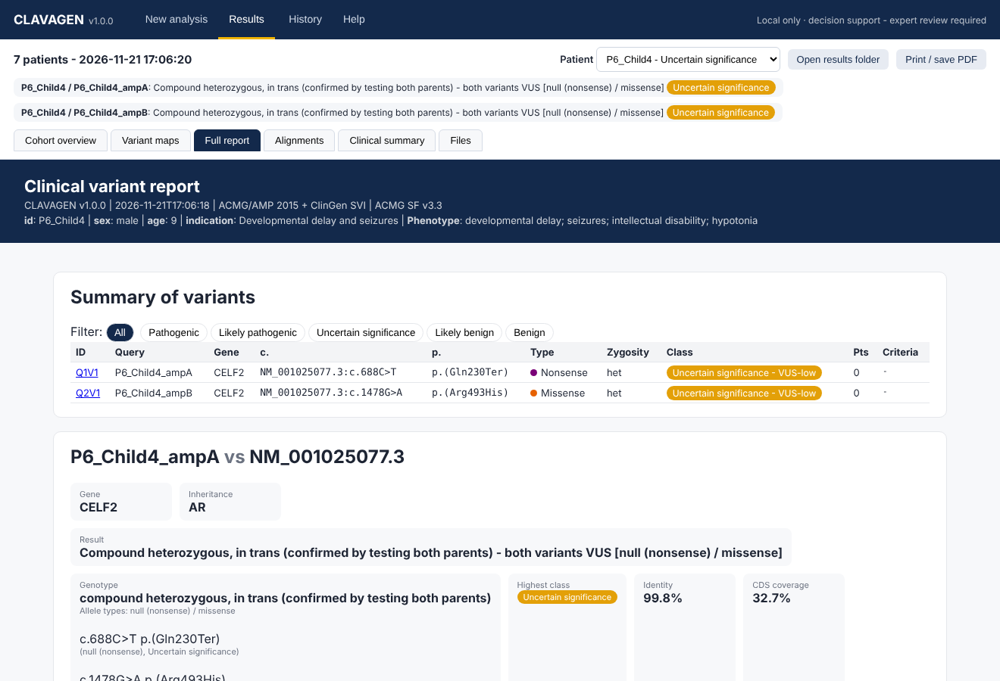

# CLAVAGEN
[](https://doi.org/10.5281/zenodo.24446017)
**CL**assification · **A**lignment · **VA**riant calling · **GEN**otype & **GEN**ealogy

ACMG/AMP variant classification for patients and families, from DNA, protein or Sanger sequences.

   

CLAVAGEN is a desktop application for individual patients and whole families:
- **Input:** it reads DNA sequences, protein sequences and Sanger traces (`.ab1`) in common file formats, against one or several reference genes.
- **Variant calling:** it aligns each sequence to its reference and calls substitutions, insertions, deletions and frameshifts, with standard HGVS names and zygosity.
- **Annotation:** it annotates each variant automatically from ClinVar, gnomAD, Ensembl VEP and UniProt.
- **Classification:** it applies the ACMG/AMP guidelines with ClinGen refinements.
- **Genotype:** it builds each patient's genotype, including compound heterozygosity and variant types.
- **Family analysis:** it uses relatives' results to establish de novo status, phase, segregation and couples' reproductive risk.
- **Output:** it produces variant maps, local alignments, chromatograms, pedigrees and clinician-ready reports.

> **Decision-support tool.** All automated classifications must be reviewed by a qualified clinical scientist or medical geneticist before clinical use.



## Features

| Area | What CLAVAGEN does |
|---|---|
| **Input** | DNA (FASTA, multi-FASTA, `.seq`, `.txt`, raw text) with IUPAC codes for heterozygous sites; protein sequences; Sanger traces (`.ab1`, forward and reverse); several references (genes) in one run; RefSeq accessions downloaded automatically |
| **Alignment & calling** | Affine-gap local alignment (pure Python, optional Biopython); SNVs, MNVs, insertions, deletions, duplications; HGVS 3′ normalisation; c. and p. names; exon/intron and NMD prediction |
| **Sanger traces** | ABIF reader, quality trimming, heterozygous SNVs from double peaks, heterozygous indels separated into two alleles (forward and reverse reads), chromatogram per variant |
| **Protein input** | Missense, nonsense, frameshift (`p.(Phe42LeufsTer19)`), stop-loss; DNA change inferred from the transcript |
| **Annotation** | ClinVar (with review stars), RefSeq, UniProt, gnomAD, Ensembl VEP (REVEL, SpliceAI, AlphaMissense); 30-day cache; offline mode |
| **Classification** | ACMG/AMP 2015 + ClinGen SVI (PVS1 decision tree, PM2_Supporting, calibrated REVEL), point-based tiers; ClinVar classification reported for known variants, automated class always shown beside it |
| **Genotype** | One genotype per patient and gene across all files: heterozygous, homozygous, compound heterozygous (in trans / in cis / phase unknown), with variant types (null, missense, in-frame …) |
| **Families** | De novo (PS2/PM6, also in siblings), phase (PM3/BP2), segregation (PP1/BS4), couple reproductive risk, pedigree drawing |
| **Outputs** | Variant maps (SVG/PNG), local alignments, chromatograms, HTML report, clinical summary (Markdown/JSON), TSV, VCF, cohort overview |
| **Benchmark** | Compares the automated engine with ClinGen expert-panel classifications (Evidence Repository) |

## Screenshots

| New analysis | Patient window (with Sanger traces) |
|---|---|
|  |  |
| **Family analysis and pedigree** | **Report with genotype** |
|  |  |

## Quick start

The only requirement is **Python 3.8 or newer** ([python.org](https://www.python.org/downloads/); on Windows tick *"Add Python to PATH"*).

```bash
git clone https://github.com/Sattar-Sol/CLAVAGEN.git
cd CLAVAGEN
```

| System | Start |
|---|---|
| macOS | double-click `CLAVAGEN.app` (first time: right-click → Open) or `Start_Mac.command` |
| Windows | double-click `Start_Windows.bat` |
| Linux | `./start_linux.sh` |

The first start creates a private environment in the folder (about a minute, needs internet once). The app opens in its own window; everything runs locally on your computer.

### Command line

```bash
python3 -m clavagen run -q patient.fa -r NM_000518.5 -o results/                 # one patient
python3 -m clavagen run -q trace_F.ab1 -q trace_R.ab1 -r reference.fa -o results/ # Sanger traces
python3 -m clavagen cohort --patients patients.csv -r HBB.fa -r SOD1.fa \
        --ref-setting SOD1:inheritance=AD/AR -o results/                          # several patients / genes / families
python3 -m clavagen benchmark --erepo erepo.tsv -o bench/                         # ClinGen benchmark
```

## Examples

| Folder | Content |
|---|---|
| `examples/CELF2_family/` | 7-member family with mixed file types (`.ab1`, `.fasta`, `.seq`, `.txt`, multi-FASTA, protein): compound heterozygous proband, carriers, de novo frameshift |
| `examples/family/` | HBB family (recessive) |
| `examples/SOD1_protein/` | protein-level queries |
| `examples/protein_frameshift/` | frameshift and nonsense in protein sequences |
| `examples/traces/` | simulated Sanger traces |
| `examples/demo_results_cohort/` | example output |

## Documentation

- [User guide](docs/USER_GUIDE.md): every option of the window and the command line.
- [Changelog](CHANGELOG.md): full history, including the earlier ACMG-VarCall versions.

## Tests

```bash
python3 -m pytest -q tests      # 44 tests, with or without Biopython
```

## Limitations

- **Scope:** it analyses targeted sequences (Sanger, amplicons, cDNA, proteins), not whole-exome or genome VCF pipelines.
- **Validation:** traces have been tested on real file formats with simulated variants. Validate on your laboratory's own data before use.
- **Reviewer input:** some criteria need it (functional studies PS3/BS3, case-control data PS4). Family evidence is applied automatically only when relatives are sequenced.
- **Databases:** online annotation needs internet access to NCBI, Ensembl, UniProt and gnomAD.

## Citation

If you use CLAVAGEN, please cite it as described in [`CITATION.cff`](CITATION.cff).

## License

[MIT](LICENSE).
